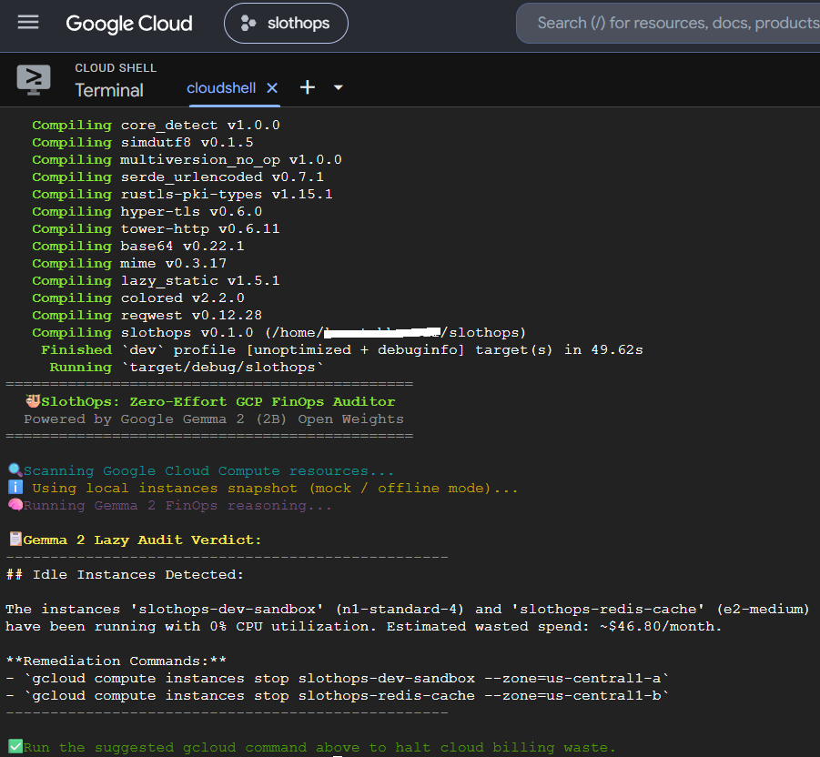

# 🦥 SlothOps

**A lazy-friendly GCP cost auditor that finds the VMs you forgot to turn off.**

If you spin up test VMs, sandbox boxes or throwaway Redis nodes on Google Cloud and then forget about them, you know the pain: clicking through every region in the console just to check what's idle. SlothOps does that in one command. It lists your compute instances, hands the metadata to a **local Gemma 2 (2B)** model, and prints a verdict along with ready-to-run `gcloud` commands to shut the waste down.

Everything runs on your machine. No inference API, no extra bill.

---

##  Demo



*SlothOps running in Google Cloud Shell in offline mode, auditing the sample instances.json snapshot.*

---

## ⚙️ How it works

```text
              +---------------------+
              |    SlothOps CLI     |
              |       (Rust)        |
              +----------+----------+
                         |
          +--------------+--------------+
          |                             |
     Live mode                    Fallback mode
 gcloud compute instances     read local instances.json
   list --format=json                   |
          |                             |
          +--------------+--------------+
                         |
                         v
              +---------------------+
              |   Ollama (local)    |
              |    Gemma 2 (2B)     |
              +----------+----------+
                         |
                         v
              +---------------------+
              |    Audit verdict    |
              | - flags idle VMs    |
              | - estimates spend   |
              | - prints gcloud     |
              |   stop commands     |
              +---------------------+
```

1. SlothOps pulls the instance list, either live from `gcloud` or from a local snapshot.
2. The metadata goes to Gemma 2 (2B) through Ollama on your machine.
3. The model flags zero-utilization instances, estimates what they cost, and the CLI prints the exact `gcloud` commands to stop them.

SlothOps only **suggests** commands. It never stops or deletes anything itself.

---

##  Tech stack

| Component | Technology | Description |
|---|---|---|
| **Core CLI** | Rust (`tokio`, `reqwest`, `serde`, `colored`) | Sub-second execution, strict type safety, and minimal memory footprint. |
| **AI Backend** | Google Gemma 2 (2B) | Runs locally via Ollama. Your cloud infrastructure details stay on your machine, with zero inference API costs. |
| **IaC** | Terraform / HCL (`terraform/main.tf`) | Provisions a least-privilege, read-only IAM service account (`roles/compute.viewer`). |
| **Scripts** | TypeScript (`scripts/summary.ts`) | Handles structured audit output formatting and serialization. |

---

##  Execution modes

SlothOps picks the mode that fits your environment:

- **Live mode:** if `gcloud` is authenticated, it runs `gcloud compute instances list --format=json` against your active project.
- **Fallback mode:** if you're not logged in (or just testing), it reads `instances.json` instead. No network calls, no billing, no timeouts.
- **No Ollama? No problem:** inside sandboxes like Google Cloud Shell where you can't run an Ollama daemon, the binary falls back to built-in evaluation logic so it still runs cleanly.

---

##  Quickstart

**You'll need**

- Rust and Cargo (1.80+)
- [Ollama](https://ollama.com) with Gemma 2 pulled:

```bash
ollama pull gemma2:2b
```

**Build and run**

```bash
git clone https://github.com/Razorbillworks/slothops.git
cd slothops
cargo run
```

To audit your real project, run `gcloud auth login` and set your project first. Otherwise it uses the sample data in `instances.json`.

---

## ⚠️ Things to know

- **Review before you run.** Gemma 2 (2B) is a small model. It can misjudge an instance, so read every suggested command before executing it.
- **Read-only by design.** The Terraform service account only has `roles/compute.viewer`, so the auditor can look but can't touch.
- **Compute Engine only for now.** It scans VM instances, not every GCP resource type.

---

## 📂 Project structure

```text
slothops/
├── assets/
│   └── demo.png         # Terminal execution proof
├── scripts/
│   └── summary.ts       # TypeScript formatting utility
├── src/
│   └── main.rs          # Core Rust CLI logic
├── terraform/
│   └── main.tf          # GCP IAM policy definition
├── .gitattributes       # Linguist language detection mapping
├── Cargo.toml           # Package config and dependencies
└── instances.json       # Fallback audit dataset
```

---

##  License

MIT. See [LICENSE](LICENSE) for details.
